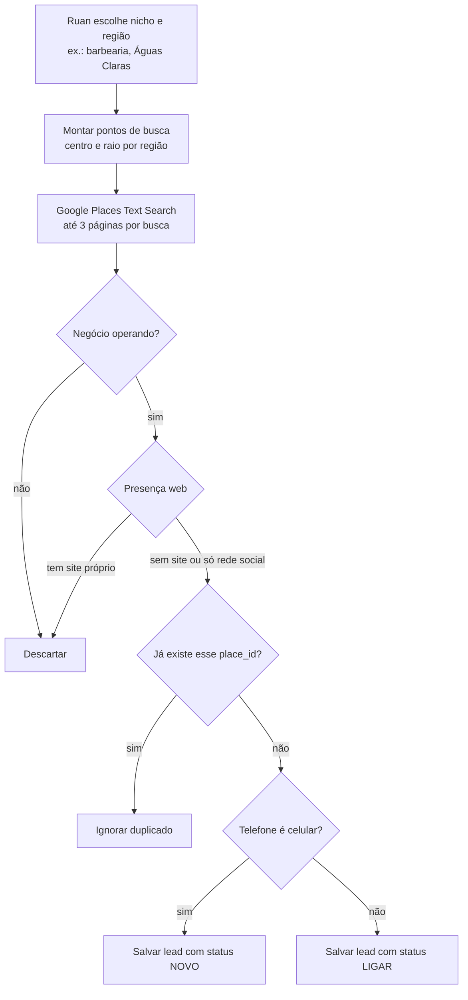
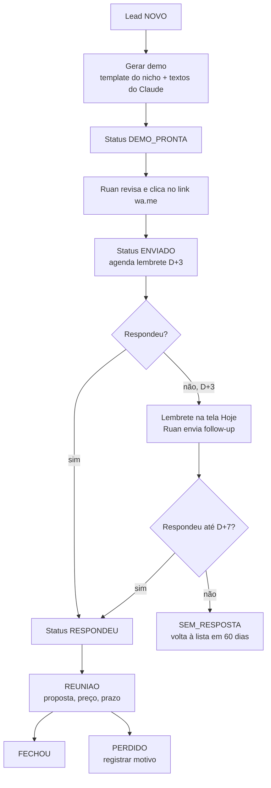

# Plano do projeto: Sistema de Prospecção (Prospect)

Este documento é a fonte da verdade do projeto. Qualquer agente (Antigravity ou Claude Code) deve ler este arquivo antes de começar uma tarefa e seguir as decisões registradas aqui. Se algo aqui conflitar com um pedido, pergunte ao Ruan antes de seguir.

## 1. Contexto

Sou o Ruan Máximo, desenvolvedor backend em Brasília (DF), PJ pela 4R Tech. Este sistema tem dois objetivos:

1. Encontrar pequenos negócios sem site próprio (barbearias, hamburguerias, pet shops, advogados, contabilidades etc.), abordar cerca de 10 por dia pelo WhatsApp e fechar a venda de sites e sistemas web.
2. Servir como projeto de portfólio, com código limpo, testes e um case com números reais.

Inspiração: um sistema de um amigo que busca leads no OpenStreetMap. Ele fechou 3 vendas, mas o sistema é lento, sem filtro e com cobertura fraca. Este projeto resolve isso usando a Google Places API (New), filtro de presença web e um funil de vendas completo.

## 2. Decisões já tomadas (não mudar sem perguntar)

1. **Base:** monorepo criado a partir do `mvp-universal-template` (pnpm, NestJS 11, Prisma 7, PostgreSQL, Next.js 15, Tailwind v4, Zod em `@mvp/shared`, Vitest). Seguir todas as regras de `.agents/rules/` e o fluxo de branches do template.
2. **Fonte de leads:** Google Places API (New), endpoint **Text Search** (`places:searchText`). Não usar Nearby Search, porque ele não pagina e para em 20 resultados. O Text Search retorna até 20 por página e até 3 páginas (60 por busca).
3. **WhatsApp semi-automático:** o sistema NÃO envia mensagens sozinho. Ele gera a mensagem personalizada e um link `https://wa.me/55DDDNUMERO?text=...`; o Ruan clica e envia pelo WhatsApp Business dele. Motivos: bibliotecas não oficiais (Baileys, Evolution API e afins) para mensagem fria levam a banimento do número, e a API oficial exige template aprovado e opt-in, o que não serve para prospecção fria. Não implementar envio automático em nenhuma fase sem pedido explícito.
4. **Sem scraping de Instagram:** viola os termos e quebra com frequência. A logo entra manualmente quando o lead responder.
5. **Demo automática:** cada lead pode ganhar uma página de demonstração em `/demo/[slug]`, montada a partir de um template por nicho, com dados do lead e textos gerados pelo Claude. O Ruan sempre revisa antes de enviar.
6. **Lembretes, não disparos:** follow-ups (D+3 e D+7) aparecem como tarefas na tela "Hoje". Quem envia é o Ruan.
7. **Custo baixo:** tudo deve caber em planos gratuitos ou quase (Places dentro da cota grátis, banco Neon ou Supabase grátis, demos em Netlify ou Cloudflare Pages). Não usar o plano Hobby da Vercel para nada comercial.

## 3. Fluxo do sistema

### 3.1 Coleta de leads (automática)



### 3.2 Abordagem e funil (semi-automático)



## 4. Modelo de dados (rascunho para o Prisma)

Ajustar nomes ao padrão do template, mas manter a ideia.

```prisma
enum LeadStatus {
  NOVO
  LIGAR
  DEMO_PRONTA
  ENVIADO
  RESPONDEU
  REUNIAO
  FECHOU
  PERDIDO
  SEM_RESPOSTA
  DESCARTADO
}

enum PresencaWeb {
  SEM_SITE
  SO_REDE_SOCIAL
  TEM_SITE
}

enum TipoInteracao {
  MENSAGEM_ENVIADA
  FOLLOW_UP
  RESPOSTA
  LIGACAO
  REUNIAO
  MUDANCA_STATUS
  NOTA
}

model Regiao {
  id         String   @id @default(uuid())
  nome       String   // "Águas Claras"
  cidade     String   // "Brasília"
  uf         String   // "DF"
  lat        Float
  lng        Float
  raioMetros Int      @default(4000)
  ativa      Boolean  @default(true)
  leads      Lead[]
  buscas     Busca[]
}

model Busca {
  id              String   @id @default(uuid())
  nicho           String
  regiaoId        String
  regiao          Regiao   @relation(fields: [regiaoId], references: [id])
  totalEncontrado Int
  totalNovos      Int
  chamadasApi     Int
  criadaEm        DateTime @default(now())
}

model Lead {
  id               String        @id @default(uuid())
  placeId          String        @unique
  nome             String
  nicho            String
  endereco         String?
  regiaoId         String?
  regiao           Regiao?       @relation(fields: [regiaoId], references: [id])
  telefone         String?
  ehCelular        Boolean       @default(false)
  website          String?
  instagram        String?
  presencaWeb      PresencaWeb
  nota             Float?
  totalAvaliacoes  Int?
  googleMapsUri    String?
  status           LeadStatus    @default(NOVO)
  slug             String?       @unique
  proximoContatoEm DateTime?
  motivoPerda      String?
  observacoes      String?
  criadoEm         DateTime      @default(now())
  atualizadoEm     DateTime      @updatedAt
  interacoes       Interacao[]
  demo             Demo?

  @@index([status])
  @@index([nicho])
  @@index([proximoContatoEm])
}

model Interacao {
  id       String        @id @default(uuid())
  leadId   String
  lead     Lead          @relation(fields: [leadId], references: [id], onDelete: Cascade)
  tipo     TipoInteracao
  conteudo String?
  criadaEm DateTime      @default(now())
}

model Demo {
  id            String    @id @default(uuid())
  leadId        String    @unique
  lead          Lead      @relation(fields: [leadId], references: [id], onDelete: Cascade)
  template      String    // "barbearia", "hamburgueria"...
  dados         Json      // textos, cores, serviços, horários
  logoUrl       String?   // preenchida manualmente quando o lead responder
  publicadaEm   DateTime?
  visualizacoes Int       @default(0)
}
```

## 5. Integração com o Google Places

### 5.1 Configuração

1. Projeto no Google Cloud com a **Places API (New)** ativada.
2. Chave restrita somente a essa API, guardada em `GOOGLE_PLACES_KEY` no `.env` (nunca versionar).
3. **Limite de cota diária** configurado no console. Alerta de orçamento só avisa; a cota é o que impede uma conta surpresa se houver loop no código.
4. Telefone e site são campos da faixa Enterprise do Text Search, que tem 1.000 chamadas grátis por mês. Cada chamada traz até 20 lugares, então para ~10 contatos por dia sobra muito.

### 5.2 Chamada

```ts
const FIELDS = [
  'places.id', 'places.displayName', 'places.formattedAddress',
  'places.nationalPhoneNumber', 'places.websiteUri', 'places.rating',
  'places.userRatingCount', 'places.businessStatus', 'places.googleMapsUri',
  'nextPageToken',
].join(',');

async buscarNegocios(texto: string, lat: number, lng: number, raio = 4000) {
  const resultados = [];
  let pageToken: string | undefined;

  do {
    const res = await fetch('https://places.googleapis.com/v1/places:searchText', {
      method: 'POST',
      headers: {
        'Content-Type': 'application/json',
        'X-Goog-Api-Key': process.env.GOOGLE_PLACES_KEY!,
        'X-Goog-FieldMask': FIELDS,
      },
      body: JSON.stringify({
        textQuery: texto,
        languageCode: 'pt-BR',
        regionCode: 'BR',
        pageSize: 20,
        pageToken,
        locationBias: { circle: { center: { latitude: lat, longitude: lng }, radius: raio } },
      }),
    });
    const data = await res.json();
    resultados.push(...(data.places ?? []));
    pageToken = data.nextPageToken;
  } while (pageToken);

  return resultados;
}
```

Regras:

1. O `X-Goog-FieldMask` é obrigatório e define o custo. Pedir só os campos usados.
2. Registrar quantas chamadas cada busca fez (`Busca.chamadasApi`) para acompanhar a cota.
3. Tratar erro e timeout da API sem derrubar a busca inteira.
4. A chamada ao Google fica isolada num service próprio (ex.: `GooglePlacesClient`) para poder ser mockada nos testes.

### 5.3 Classificação

```ts
const REDES = /instagram\.com|facebook\.com|linktr\.ee|wa\.me|ifood/i;

function classificar(p): 'SEM_SITE' | 'SO_REDE_SOCIAL' | 'TEM_SITE' | 'DESCARTAR' {
  if (p.businessStatus && p.businessStatus !== 'OPERATIONAL') return 'DESCARTAR';
  if (!p.websiteUri) return 'SEM_SITE';
  if (REDES.test(p.websiteUri)) return 'SO_REDE_SOCIAL';
  return 'TEM_SITE';
}

const ehCelular = (tel?: string) => !!tel && /\(\d{2}\)\s?9\d{4}-\d{4}/.test(tel);
```

Esses dois são funções puras: ficam em `@mvp/shared` (domínio) e têm testes unitários com vários casos reais.

### 5.4 Regiões iniciais (Brasília)

Asa Sul, Asa Norte, Sudoeste, Lago Sul, Lago Norte, Guará, Águas Claras, Taguatinga, Vicente Pires, Ceilândia, Samambaia, Gama, Sobradinho, Planaltina. Criar via seed com latitude e longitude do centro de cada região e raio de 4 km.

## 6. Mensagem de WhatsApp

O link é montado assim: `https://wa.me/55${numeroSoDigitos}?text=${encodeURIComponent(mensagem)}`.

As mensagens ficam em templates por nicho com variáveis (`{nome}`, `{bairro}`, `{linkDemo}`). Exemplo de primeira abordagem (o tom deve ser natural, curto e sem cara de robô):

> Oi, tudo bem? Aqui é o Ruan, sou desenvolvedor aqui de Brasília. Vi a {nome} no Google e montei uma prévia de como poderia ficar um site de vocês: {linkDemo}
> Fiz sem compromisso, só pra vocês verem. Se curtirem, posso colocar a logo e ajustar do jeito de vocês.

Ao clicar em "Enviar no WhatsApp", o sistema registra uma `Interacao` do tipo `MENSAGEM_ENVIADA`, muda o status para `ENVIADO` e define `proximoContatoEm` para D+3.

## 7. Roadmap

### Fase 0: preparação

- [x] Rodar `/comecar` (ambiente, `.env`, banco, migrations, seed)
- [x] Rodar `/renomear-projeto` (nome: Prospect)
- [x] Rodar `/remover-exemplo` (remove a feature `tasks`)
- [ ] Criar projeto no Google Cloud, ativar Places API (New), gerar chave restrita e configurar cota diária
- [ ] Em paralelo: prospectar 10 negócios manualmente (não esperar o sistema ficar pronto)

### Fase 1: coleta e funil (dias 1 a 4)

- [x] Models `Regiao`, `Busca`, `Lead`, `Interacao` + migration + seed das regiões
- [x] Schemas Zod em `@prospect/shared` (lead, filtros, status, transição de status)
- [x] Funções puras `classificar` e `ehCelular` com testes
- [x] `GooglePlacesClient` isolado + `BuscaService` (busca, classifica, deduplica por `placeId`, salva)
- [x] Endpoint `POST /buscas` (nicho + regiões) e `GET /leads` com filtros (status, nicho, região, presença web) e paginação
- [x] Tela de nova busca (nichos em chips, seleção de regiões, botão buscar, resumo do resultado)
- [x] Tela de funil em kanban por status, com card do lead (nome, bairro, nota, presença web, botões WhatsApp e Maps)
- [x] Botão "Enviar no WhatsApp" que gera o link `wa.me`, registra a interação e muda o status
- [x] Mudança manual de status com registro em `Interacao`

**Pronto quando:** consigo buscar "barbearia" em 3 regiões, ver só quem não tem site, e mover leads pelo funil com histórico.

### Fase 2: demos (dias 5 a 10)

- [x] Model `Demo` + migration
- [x] Rota pública `/demo/[slug]` no Next.js, com template de **barbearia** e de **hamburgueria** (começar só com esses dois)
- [x] Geração de textos com a API do Claude (`ANTHROPIC_API_KEY`): título, descrição, lista de serviços, chamada para ação, sempre em português natural
- [x] Paleta de cores por nicho; campo de logo opcional para preencher manualmente
- [x] Contador de visualizações da demo (sinal de interesse do lead)
- [x] Botão "Gerar demo" no card do lead; status vai para `DEMO_PRONTA`
- [x] Tela de pré-visualização para revisar antes de enviar

**Pronto quando:** gero a demo de uma barbearia real em um clique, reviso e mando o link no WhatsApp.

### Fase 3: follow-up e métricas (semana 3)

- [ ] Tela "Hoje": leads com `proximoContatoEm` vencido, com mensagem de follow-up pronta
- [ ] Regras: sem resposta em D+3 gera lembrete; sem resposta em D+7 vira `SEM_RESPOSTA` e volta para a lista em 60 dias
- [ ] Histórico completo de interações no detalhe do lead
- [ ] Painel com taxa de resposta e de fechamento por nicho, por região e por template de mensagem

### Fase 4: portfólio (depois das primeiras vendas)

- [ ] README com o problema, a solução, prints e o fluxograma
- [ ] Versão pública com dados fictícios (seed de demonstração)
- [ ] Case com números reais: leads encontrados, respostas, reuniões, vendas
- [ ] Avaliar API oficial do WhatsApp só se o volume crescer muito

## 8. Variáveis de ambiente

```
DATABASE_URL=
GOOGLE_PLACES_KEY=
ANTHROPIC_API_KEY=        # fase 2
DEMO_BASE_URL=            # ex.: https://demos.4rtech.com.br
```

## 9. Riscos e cuidados

1. **Termos do Google:** o `place_id` pode ser armazenado sem limite; os demais campos do Places têm restrições de cache. Para o uso pessoal do MVP, guardamos o necessário para operar o funil, mas antes de escalar ou vender o sistema para terceiros é preciso revisar os termos e, se for o caso, atualizar dados via Place Details no momento do uso. Fotos do Google exigem atribuição.
2. **Cota da API:** nunca rodar busca em loop sem limite; sempre respeitar a cota diária.
3. **LGPD:** guardar só dados públicos do negócio e o histórico de contato; permitir marcar "não quer contato" (usar `DESCARTADO` com motivo) e nunca mais abordar esse lead.
4. **Segredos:** chaves só no `.env`. Os hooks do template já bloqueiam leitura e commit de `.env`.

## 10. Como trabalhar com os agentes

1. Uma feature por vez, sempre em branch `feature/<nome>` a partir de `develop` (`/git-fluxo`).
2. Para cada item do roadmap, usar `/nova-feature` descrevendo o resultado de negócio.
3. Antes de cada merge, rodar `/verificar` (typecheck, lint, test, build).
4. Commits com `/git-commit`.
5. Ao terminar um item, marcar o checkbox neste arquivo.
6. Textos de interface e mensagens em português, com acentos, tom natural e sem travessões.
